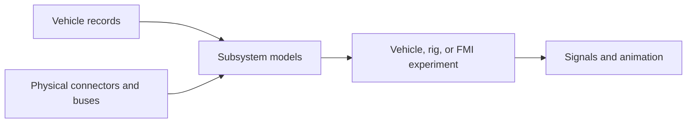

# BobLib

BobLib is the Modelica vehicle library. It contains suspension, tire, aero,
powertrain, and control models connected through physical connectors and
VehicleInterfaces contracts.

| Task | Guide |
| --- | --- |
| Installation and first translation | [Setup](/boblib/setup) |
| Diagrams and interactive simulation | [OMEdit workflow](/boblib/omedit-workflow) |
| Scripted translation and simulation | [Command line](/boblib/cli-workflow) |
| Vehicle composition | [Records and templates](/boblib/generation) |
| Experiment inputs and outputs | [Entry points](/boblib/entry-points) |
| Regression checks | [Tests and checks](/boblib/testing) |
| Upcoming architecture | [Unreleased development preview](/boblib/unreleased) |

## Published library

These guides describe published `main` at `ea7dda2`, inspected on
19 October 2026. The package declares version `0.2.0`, Modelica Standard
Library `4.1.0`, and VehicleInterfaces `2.0.2`.

The standard entry points are `VehicleSim`, `FourPostSim`, and `VehicleFMI`
under `BobLib.Experiments.Standards`. They extend checked-in architecture
templates and use Modelica vehicle records. Animation is enabled by default
with `headless = false`.

Standalone BobLib needs no YAML generation. [BobSim](/bobsim/) supplies a
separate vehicle editor and generator that writes records for its pinned
BobLib checkout. A standalone checkout and BobSim's submodule can be at
different revisions.

## Model structure

[Package map](/boblib/package-map) describes the source tree.
[Control bus](/boblib/control-bus) explains signal ownership.
`BobLib.UsersGuide` contains the guide shipped with each package revision.

The [development preview](/boblib/unreleased) is a separate, unreleased API.
Passing regression checks establishes consistency with the test cases. It does
not establish agreement with a particular real vehicle.
