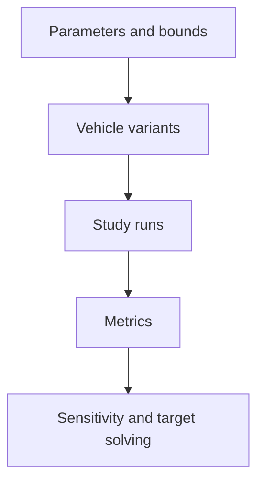

# Parameter studies

BobSim's optimization tools answer different questions. They do not all search
for a universally best vehicle.

| Tool | Question | Input |
| --- | --- | --- |
| `opt-standard` | Which parameters affect the chosen response metrics? | Parameter ranges and a study scope |
| `opt-refined` | What does the response surface look like near a selected region? | A refined sampling scope |
| `opt-solve` | Which setup approaches specified metric targets? | Targets, bounds, and available response data |
| `opt-trade` | How do named vehicles compare? | Explicit vehicle definitions |
| `opt-envelope` | Which parameters affect the legacy envelope model? | Envelope sensitivity configuration |

## Pipeline

The response-study pipeline lives in `optimization/response/`.
`configs/vehicle_architecture.yaml` describes the architecture and sampling
scope. The pipeline generates its DOE config, creates vehicle variants, runs
studies, extracts metrics, and builds sensitivity or response-surface results.

The generated `_doe_config.yaml` records the scope of its population. Editing
it afterward can detach results from their inputs. Consumers that need vehicle
variants use `pipeline/variants.py` and its `VariantStore`.

Four-post motion-ratio data is a prerequisite for relevant response studies.
The pipeline generates missing prerequisite data rather than substituting an
unrelated vehicle's ratios.

## Compile-time parameters

OpenModelica can accept an override that does not affect an expression already
evaluated during translation. Geometry, mass, static toe, and camber need
particular care. The runtime-safe paths in `pipeline/overrides.py` are the
verified exception. Other changes require a corresponding compiled variant.

## Envelope model boundary

The legacy envelope sensitivity pipeline is separate from the DynPy
3/6/10/14 DOF [GGV workflow](/bobsim/envelope). Its results should not be labeled
as a selected DynPy fidelity or combined with those runs without checking the
model assumptions.

## Review

Useful comparisons retain the vehicle, parameter bounds, solver settings, and
metric definitions. A fitted surface needs confirmation with direct runs near
the selected setup. A sensitivity ranking only applies to the sampled range.

`make opt-doe-smoke` checks config generation, record sampling, and variant
writing without a Modelica toolchain. It does not simulate the population.
