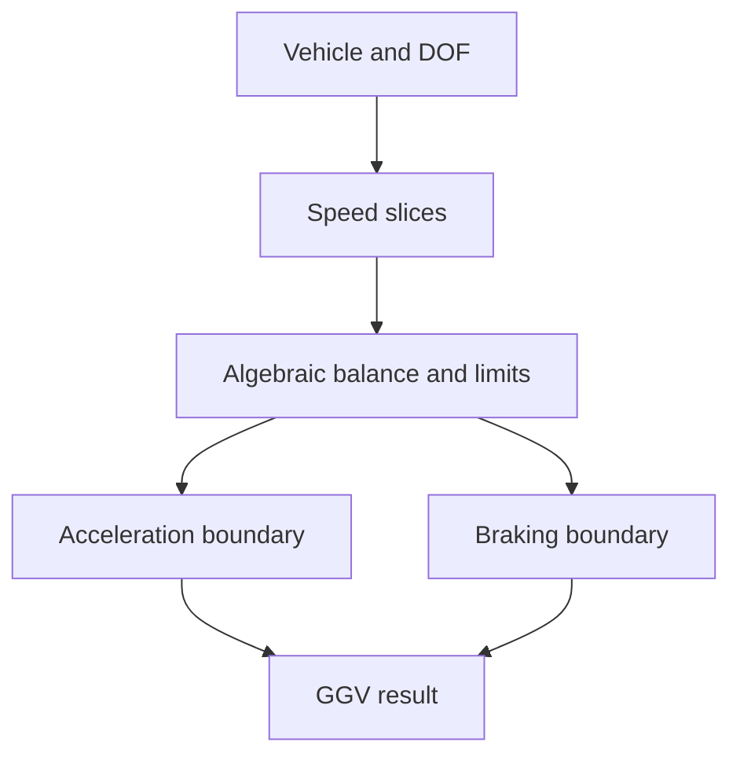

# GGV and yaw moment diagrams

Both analyses use DynPy with KinPy geometry and the vehicle's tire models.
They solve operating points rather than integrating a maneuver through time.

## GGV

A GGV is the acceleration boundary over speed. Each slice has path-tangential
acceleration $a_t$ and path-normal acceleration $a_n$.



At a sampled speed and lateral demand, the solver holds sideslip locally
constant and sets heading rate from the path condition:

$$
\dot\beta=0,\qquad \dot\psi=\frac{a_n}{V}.
$$

It solves for the remaining operating state, including steering, torque, and
the suspension and wheel states retained by the model. The constrained search
finds the upper and lower feasible tangential accelerations:

$$
a_t^{\mathrm{upper}}=\max_{\mathrm{feasible}} a_t,\qquad
a_t^{\mathrm{lower}}=\min_{\mathrm{feasible}} a_t.
$$

The constraints include tire fits, contact loads, steering, sideslip, torque,
power, and force and moment balance. Neighboring solutions seed the next solve.
The lateral endpoint is searched separately with tangential acceleration free.
Tire lift is not an accepted operating point.

### Angular balance

Zero yaw acceleration is not zero yaw rate. For a full inertia tensor,

$$
\mathbf I\dot{\boldsymbol\omega}
=\mathbf M-\boldsymbol\omega\times(\mathbf I\boldsymbol\omega).
$$

Thus zero body angular acceleration does not generally imply zero net moment.
The equations retain the required inertial terms.

### Sampling and interpretation

Speed coverage and acceleration search bounds are generated from the vehicle.
The current generator uses nine speed slices. Both cornering directions are
solved independently when enabled. A symmetric vehicle may produce similar
branches, but the implementation does not assume that result.

The upper longitudinal boundary can be negative when the vehicle cannot
sustain its speed. A missing or non-converged point is not proof that every
nearby operating state is physically impossible. These are local numerical
searches, not a global optimality or dynamic-stability guarantee.

The result includes an envelope CSV, plots, metrics, and a report.
[QSS Lap](/bobsim/laptime) uses this saved envelope directly.

## Yaw moment diagram

YMD sweeps nominal front roadwheel angle $\delta$ and body sideslip $\beta$ at
prescribed speed and yaw rate. Longitudinal and retained vertical and wheel
states are equilibrated. Lateral acceleration and yaw moment are outputs:

$$
(\delta,\beta)\longmapsto(a_y,M_z).
$$

Most map points deliberately have nonzero yaw moment. They are not steady
cornering solutions. A zero-moment crossing identifies a candidate trim branch,
not proof of time-domain stability. Failed cells are excluded from valid plots.

## Command line

```bash
make envelope-ggv
make envelope-ymd
```

Source: [GGV generation](https://github.com/BobDyn/BobSim/blob/main/simulations/envelope/ggv/ggv_generation.py),
[YMD](https://github.com/BobDyn/BobSim/tree/main/simulations/envelope/ymd), and
[quasi-steady equations](https://github.com/BobDyn/BobSim/blob/main/engines/dynpy/qss.py).
