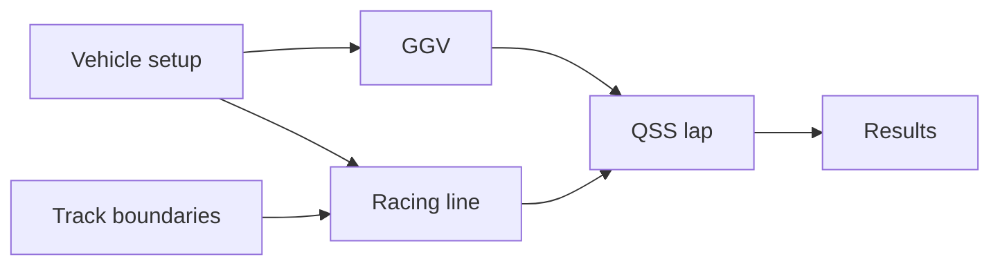

# BobSim

BobSim is the vehicle setup and analysis workspace. One vehicle definition
supplies suspension geometry, tires, mass, aero, and powertrain data to the
available models.

| Task | Guide |
| --- | --- |
| Installation and first run | [Getting started](/startup-guide/bobsim) |
| Vehicle definition | [Vehicle setup](/bobsim/configuration) |
| Model selection | [Models and fidelity](/bobsim/models) |
| Analysis tree and linked inputs | [Simulation workspace](/bobsim/app) |
| Plots, reports, and signal comparisons | [Results](/bobsim/results) |
| Scripted studies | [Command line](/use-guide/bobsim-cli) |

## Analyses

The Simulation tree has five persistent groups. Each simulation has its own
Setup and Results entries.

| Group | Analyses | Purpose |
| --- | --- | --- |
| Kinematics | Four post | Suspension geometry, motion ratios, stiffness, and compliance |
| Performance envelopes | GGV, YMD | Acceleration limits and yaw balance |
| Vehicle response | Maneuver | Ramp, step, or sine steering response |
| Track | Racing line | A fixed path from track boundaries and vehicle clearance |
| Laptime | QSS lap, Transient lap | Speed profile or driver-controlled time response |

QSS Lap inherits fidelity and power limits from its linked GGV. Its racing line
comes from a separate Track analysis. These inputs can be reused across laps.

## Engines

- **KinPy** solves suspension geometry and supplies corner lookups.
- **DynPy** evaluates 3, 6, 10, or 14 DOF vehicle models in Python.
- **BobLib** supplies Modelica multibody models compiled by OpenModelica.

Model fidelity and analysis method are separate choices. A 14 DOF GGV still
solves quasi-steady operating points. It does not integrate a transient lap.

## Version scope

These pages describe BobSim `main` after the simulation workspace stack merged
on 19 October 2026. The latest desktop release checked for this update is
`v2026.10.13`. Its interface can differ. The [source installation](/startup-guide/bobsim)
provides the interface described here.

BobSim uses a pinned BobLib submodule. The [BobLib development preview](/boblib/unreleased)
is separate from that integration.
