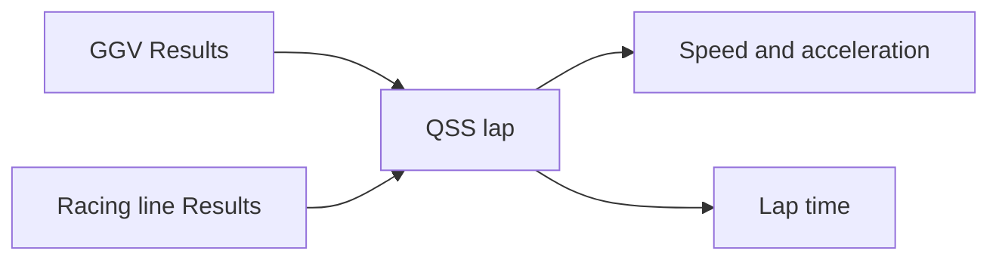

# Lap simulation

QSS Lap solves a speed profile on a fixed path. Transient Lap integrates a
vehicle following a reference with a feedback driver. Their lap times answer
different questions.

## QSS inputs



A QSS Lap in the app requires both connections. The linked GGV owns model
fidelity, tire and vehicle assumptions, and power limits. The linked Racing
line owns the saved path. The lap has no independent power cap or fidelity
selector to contradict its inputs.

Completed source Results can be dragged to the lap's input entries. Changed
inputs must be regenerated before an incompatible connection can be used.

## Speed profile

Path curvature sets lateral demand:

$$
a_n(s)=v(s)^2\kappa(s).
$$

The corresponding GGV slice gives acceleration and braking bounds. Forward
acceleration and backward braking passes enforce those bounds around the
closed circuit. A segment with approximately constant tangential acceleration
satisfies

$$
v_{i+1}^2=v_i^2+2a_{t,i}\Delta s_i.
$$

The solver iterates the closed-lap profile. Segment travel time uses both
endpoint speeds, and the sum gives lap time.

QSS does not integrate body, wheel, or suspension transients around the lap.
Even a 14 DOF source envelope describes local quasi-steady capability. Tire
relaxation, actuator delay, and the time required to build roll response are
not represented by the lap propagation.

## Envelope coverage

The linked GGV range limits the lap's speed range. A result resting on its
upper speed edge may be envelope-limited rather than power-limited. The report
records that coverage. Signed curvature selects the appropriate turn branch.

The lap uses its linked path without re-optimization. A faster result does not
establish the globally fastest racing line.

## Transient lap

The current transient workflow generates a QSS reference and follows it with
steering feedforward plus heading and cross-track feedback. Longitudinal
feedback follows the target speed. Its configurable event power cap belongs
to this separate reference-generation workflow.

DynPy then integrates the selected vehicle model. The result records target
and actual speed, tracking error, yaw response, and retained body and wheel
states. It uses RK45 for 3 DOF and Radau for 6/10/14 DOF.

Track departure is measured, not prevented by a hard corridor constraint in
the driver. A run may fail to complete its lap within the time horizon.
Lap-time comparison is meaningful only after checking completion and tracking.

## Results

QSS Results use a static track map colored by a saved signal, plus plots and a
report. Transient signals can drive the vehicle replay. Signal Explorer plots
time histories or parametric relationships, with an optional third signal
shown by color.

## Command line

```bash
make lap-eval-qss
make lap-eval-transient
```

The standalone runner reads `simulations/lap/lap_time_eval_config.yml` and can
generate missing inputs. That differs from the app's explicit QSS connections.
`LAP_CONFIG` selects another file and `LAP_DOF` selects a model.

Source: [QSS solver](https://github.com/BobDyn/BobSim/blob/main/simulations/lap/core/qss.py)
and [transient lap](https://github.com/BobDyn/BobSim/blob/main/simulations/lap/core/transient.py).
