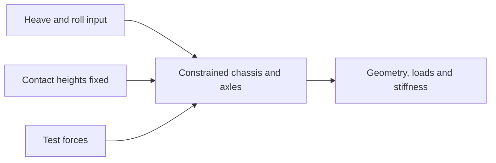

# Vehicle response and four post

These workflows share a vehicle definition but solve different problems.
The app exposes Four post under Kinematics and Maneuver under Vehicle response.
Existing command-line names retain the `standard-` prefix.

## Four post

BobLib's rig prescribes chassis roll about global x and heave along the rotated
local z axis. Contact-patch global z coordinates remain fixed. Other contact
translations and rotations remain free according to the rig's constraints.
It does not prescribe four independent wheel travels.

The standard test uses zero world gravity, spring preload, and scheduled test
forces. The steering excitation is **handwheel angle**, transmitted through
the rack-and-pinion C-factor. It is not the rack-displacement sweep in the
Setup kinematics plot.

Heave is displayed in mm and roll in degrees in the app. Front and rear
reports cover geometry, motion ratios, load response, and stiffness metrics.
The run is a constrained test, not a free-running vehicle.

## Maneuver

Maneuver combines model selection with a steering waveform:

| Input | Parameters and behavior |
| --- | --- |
| Ramp | Start, rate or magnitude, and ramp end. Steering holds after the ramp. |
| Step | Start, magnitude, and rise duration. A finite rise avoids an ideal discontinuity. |
| Sine | Amplitude and frequency. One run describes the selected excitation. |

The waveform duration and simulation stop time are distinct. The preview shows
what the input will do during the run.

DynPy steering inputs are nominal mean front **roadwheel angles**. KinPy maps
them to rack travel and individual corner poses. BobLib maneuver inputs are
**handwheel angles**. Comparing their numeric amplitudes directly is incorrect.

PI speed control adds drive or braking demand to the initial trim. It cannot
maintain target speed beyond the tire or powertrain limits. Actual speed is a
result worth reviewing alongside the steering response.

DynPy integrates

$$
\dot{\mathbf{x}}=\mathbf{f}(\mathbf{x},\mathbf{u},t).
$$

BobLib adds mechanical joint constraints to the multibody equations. Maneuver
uses RK45 for DynPy 3/6 DOF and Radau for 10/14 DOF. Saved sample spacing is
separate from the integrator's adaptive steps.

## Reports

The response report and saved signals expose steering, speed, acceleration,
yaw response, and the body and wheel states present at the selected fidelity.
A settled initial state may include nonzero suspension travel under load.
Zero travel is a geometry reference, not necessarily static equilibrium.

A single sine case is not a full frequency sweep. The legacy BobLib transient
suite runs step and sine cases across its configured speeds and frequencies.
Its fitted gain and phase depend on amplitude and the selected analysis window.

## Command-line studies

| Command | Study |
| --- | --- |
| `make standard-eval-four-post` | BobLib four-post rig |
| `make standard-eval-ramp-steer` | BobLib ramp cases |
| `make standard-eval-steady-state` | BobLib settled cornering cases |
| `make standard-eval-transient` | BobLib step and sine suite |
| `make standard-eval-all` | All four BobLib studies |
| `make reduced-eval REDUCED_DOF=6` | DynPy step response |

The settled BobLib study advances through time until its monitored responses
settle. It is different from an algebraic GGV solve.

Source: [response workflows](https://github.com/BobDyn/BobSim/tree/main/simulations/response).
