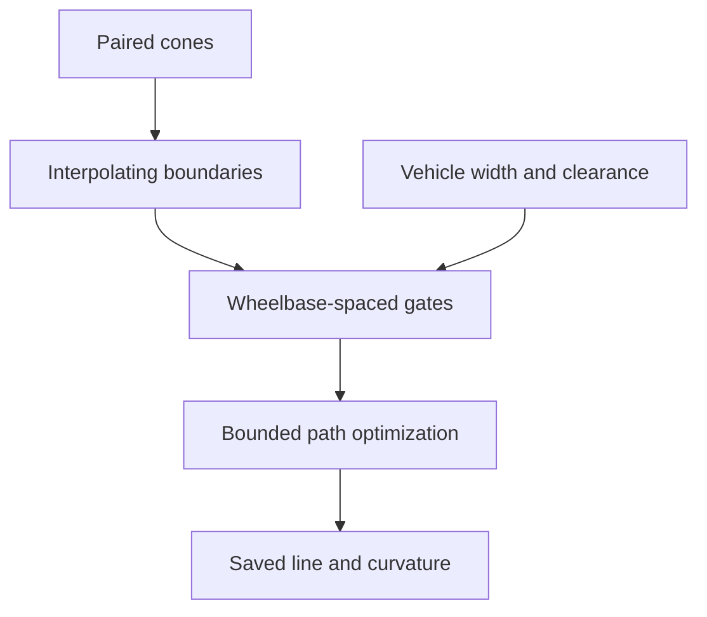

# Tracks and racing lines

A Track analysis turns paired boundary points into a reusable racing line.
The vehicle supplies the width and wheelbase. Tire grip and power do not enter
the minimum-curvature objective.

## Boundary CSV

The file has four columns, in metres:

```csv
x1,y1,x2,y2
```

Each subsequent row pairs points across the track. Rows follow the circuit in
order, and each column pair remains on the same side. The circuit closes
periodically, so a duplicated final row is unnecessary. The legacy headers
`left_x_m,left_y_m,right_x_m,right_y_m` are also accepted.

This format describes two planar boundaries. It has no elevation or banking.
A [complete example](https://github.com/BobDyn/BobSim/blob/main/simulations/lap/tracks/endurance_michigan_2019.csv)
is included in BobSim. Its source coordinates were converted from feet to
metres, as recorded in the
[track provenance](https://github.com/BobDyn/BobSim/blob/main/simulations/lap/tracks/README.md).

## Boundary interpolation and gates

Periodic cubic splines interpolate every boundary point. Refinement bounds
width between neighboring cone segments and the wider adjacent cone pair,
within 10 mm. Measured width can vary. A universal constant-width constraint
would discard that information.

Optimization gates are resampled along the paired-boundary midpoint reference.
Target spacing is the vehicle's nominal wheelbase, adjusted downward to divide
the closed circuit evenly. The original CSV pairs establish correspondence,
but do not dictate the optimization gates.



## Minimum-curvature path

At gate $i$, the path point moves along the gate normal:

$$
\mathbf p_i=\mathbf c_i+d_i\mathbf n_i.
$$

The offset is bounded by gate width $w_i$, vehicle width $w_v$, and edge
clearance $c$:

$$
|d_i|\leq\frac{w_i-w_v}{2}-c.
$$

Vehicle width is derived from the widest axle spacing plus its tire section
width. A gate with insufficient clearance is rejected.

A periodic cubic path joins the gate points. The optimization minimizes
integrated squared curvature:

$$
\min_{\mathbf d}\int\kappa(s;\mathbf d)^2\,ds.
$$

The implementation uses sparse spline solves, an analytic gradient, bounded
L-BFGS-B, and eight-point Gauss quadrature. The app also offers a centerline
mode with zero offsets.

## Scope and results

The saved result contains the boundaries, path, curvature, and generation
settings. Clearance is enforced at the resampled gates. It is not a continuous
swept-body collision check between gates.

Minimum curvature is not minimum lap time. The app's QSS lap holds this saved
path fixed. The standalone CLI has an optional, more expensive
`minimum_time_qss` search, separate from the app's Track workflow.

Source: [track geometry](https://github.com/BobDyn/BobSim/blob/main/simulations/lap/core/track.py)
and [racing-line solver](https://github.com/BobDyn/BobSim/blob/main/simulations/lap/core/racing_line.py).
