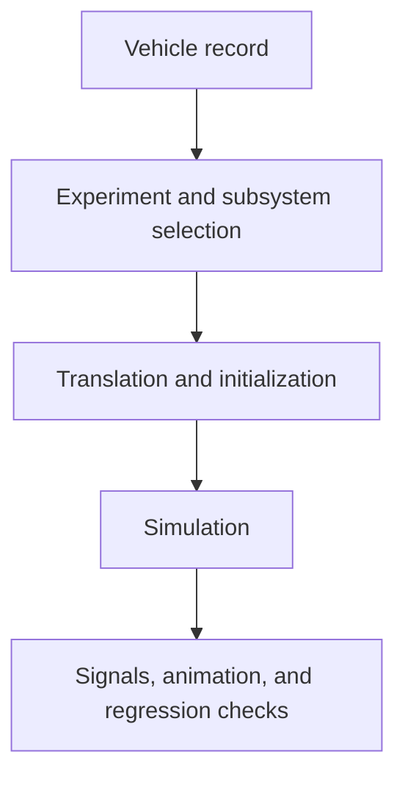

# BobLib workflow

A standalone BobLib workflow starts with a Modelica vehicle record and an
experiment. BobSim adds a vehicle editor and study runner around its pinned
copy of the library.

## Vehicle changes

[Records and templates](/boblib/generation) describes parameter ownership and
architecture selection. A geometry or mass change can affect compile-time
expressions, so a successful runtime override alone is not evidence that the
plant changed. Rebuilding the model is the reliable path for structural changes.

In BobSim, the vehicle editor writes YAML. **Write to MBD** generates the
Modelica data used by its runners. A standalone BobLib workflow edits Modelica
records directly. These are separate entry paths to the model.

## Execution and review

[OMEdit](/boblib/omedit-workflow) provides diagrams and interactive simulation.
The [CLI workflow](/boblib/cli-workflow) provides repeatable scripts.
[Entry points](/boblib/entry-points) lists experiment inputs and outputs.

The [test suite](/boblib/testing) distinguishes translation, initialization,
physics, and signal regressions. A changed baseline needs a physical explanation
and review of the newly generated results.
